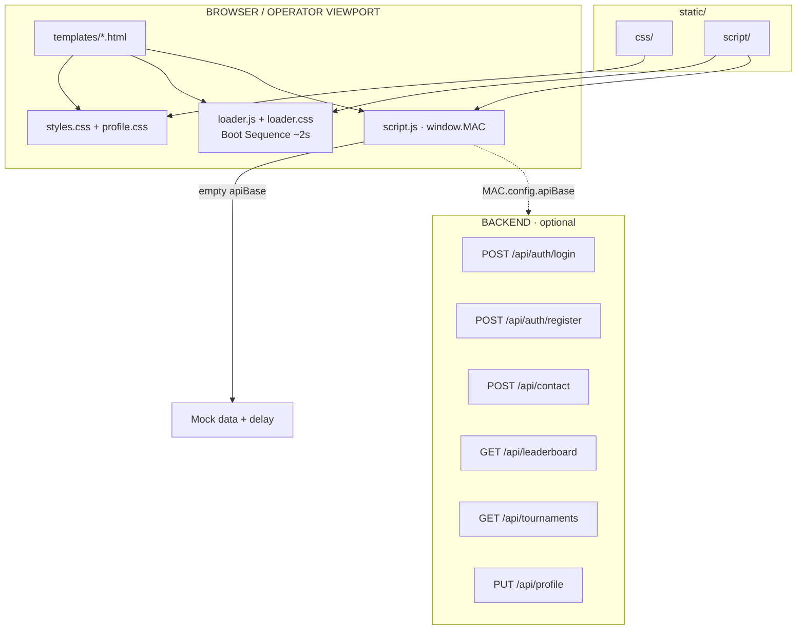

<div align="center">

```text
╔══════════════════════════════════════════════════════════╗
║                                                          ║
║     ███╗   ███╗ █████╗  ██████╗                          ║
║     ████╗ ████║██╔══██╗██╔════╝                          ║
║     ██╔████╔██║███████║██║                               ║
║     ██║╚██╔╝██║██╔══██║██║                               ║
║     ██║ ╚═╝ ██║██║  ██║╚██████╗                          ║
║     ╚═╝     ╚═╝╚═╝  ╚═╝ ╚═════╝                          ║
║                                                          ║
║        DIGITAL COMMAND  ·  FRONTEND UNIT                 ║
║        ─────────────────────────────────                 ║
║        STATUS  ▸  MISSION COMPLETE                       ║
║                                                          ║
╚══════════════════════════════════════════════════════════╝
```

# MAC — Digital Command Frontend

**Unit Insignia / Multi-page esports & marketing command UI**

[](#)
[](#)
[](#)
[](#)

`● LIVE` · Responsive · HUD Aesthetic · Mock → API Ready

</div>

---

> **MISSION BRIEF**
> A multi-page frontend built around a tactical / gaming visual identity: radar elements, scanlines, XP bars, and an orange-green palette over a dark interface. The design was created in **Figma** and implemented and polished with **Cursor** and **Claude**, with the frontend prepared for backend integration.

---

## ▸ Toolchain / How It Was Built

| Unit       | Mission Role                                                                                 |
| :--------- | :------------------------------------------------------------------------------------------- |
| **Figma**  | Design system, components, grid, typography, and overall visual direction                    |
| **Cursor** | Implementation, responsive refactoring, navigation consistency, loader, and file structure   |
| **Claude** | Frontend architecture, shared JavaScript logic, API layer, profile system, and documentation |

```text
  FIGMA  ──design system──▶  CURSOR  ──implement──▶  CLAUDE  ──polish──▶  SHIP
    │                           │                      │
    └──── HUD / tokens ─────────┴──── templates ───────┴──── MAC.api ────┘
```

---

## ▸ Frontend Architecture

The project uses a **static multi-page architecture**. Each page has its own HTML file while sharing common CSS and JavaScript, allowing the frontend to remain framework-independent and ready for backend integration.



### Layers

| Layer                  | Path                                                | Responsibility                                                                           |
| :--------------------- | :-------------------------------------------------- | :--------------------------------------------------------------------------------------- |
| **Templates**          | `templates/`                                        | Page markup, forms, sections, and UI structure                                           |
| **Design Tokens + UI** | `static/css/styles.css`                             | Color variables, header, hero, grids, responsive rules                                   |
| **Profile Skin**       | `static/css/profile.css`                            | Operator dashboard, tabs, settings, and profile modules                                  |
| **Boot Loader**        | `static/css/loader.css` + `static/script/loader.js` | Session-based gaming boot sequence                                                       |
| **App Runtime**        | `static/script/script.js`                           | Mobile navigation, animations, forms, leaderboard, tournaments, live chat, and `MAC.api` |

### Project Structure

```text
game/
├── templates/                 # Operator-facing pages
│   ├── index.html             # Landing / mission briefing
│   ├── tournaments.html       # Bracket board + filters
│   ├── live.html              # Broadcast stage + chat
│   ├── leaderboard.html       # Rankings + podium
│   ├── profile.html           # Operator dashboard
│   ├── login.html             # Authentication
│   ├── about.html
│   ├── contact.html
│   ├── terms.html
│   └── players.html           # → Redirect to leaderboard
├── static/
│   ├── css/
│   │   ├── styles.css         # Shared design system
│   │   ├── profile.css        # Profile-only modules
│   │   └── loader.css         # Boot HUD
│   └── script/
│       ├── loader.js          # Boot sequence (session once)
│       └── script.js          # Shared app logic + MAC.api
├── package.json
└── README.md                  # Project documentation
```

---

## ▸ Design System

The color palette and typography are based on the `:root` design tokens defined in `styles.css`.

| Token                   | Value                 | Usage                                       |
| :---------------------- | :-------------------- | :------------------------------------------ |
| `--bg-0`                | `#0a0c08`             | Primary background                          |
| `--panel` / `--panel-2` | `#0b0e09` / `#141a12` | HUD panels and cards                        |
| `--orange`              | `#ff6a00`             | Primary action / brand                      |
| `--amber`               | `#ffa500`             | Secondary highlights                        |
| `--green`               | `#4caf50`             | Live status / success                       |
| `--line`                | `#2e3528`             | HUD lines and borders                       |
| Display                 | **Archivo**           | Headings and UI                             |
| Mono                    | **Chakra Petch**      | Labels, logs, percentages, and HUD elements |

### Repeating Visual Patterns

* `scanlines` / `scan-sweep` / `viewport-hud`
* Tactical card corners using `.corner`
* XP / ammunition bars using `.ammo-fill`
* Hero radar and boot loader
* Glitch effects on hero headings
* `prefers-reduced-motion` support for users who reduce animation

---

## ▸ Pages & Features

| Page              | Key Features                                                                                        |
| :---------------- | :-------------------------------------------------------------------------------------------------- |
| **Index**         | Full hero, radar, mission cards, FAQ accordion, testimonial carousel, and intel cards               |
| **Tournaments**   | Search, status filters, sorting, and dynamically rendered cards from mock/API data                  |
| **Live**          | Video stage, simulated live chat, stream tabs, and schedule table                                   |
| **Leaderboard**   | Podium, paginated rankings, search, and sorting                                                     |
| **Profile**       | Statistics, Overview / Matches / Achievements / Settings tabs, toggles, and danger zone             |
| **Login**         | Sign In / Register tabs, password strength indicator, password visibility toggle, and status banner |
| **Contact**       | Brief submission form with field validation                                                         |
| **About / Terms** | Unit dossier with table of contents and scrollspy navigation                                        |

### Global Features

* **Gaming boot loader** (~2 seconds, once per session — force with `?boot=1`)
* **Mobile navigation drawer** with scroll locking and Escape / resize handling
* **Scroll reveal** animations and statistic counters using `IntersectionObserver`
* **Active navigation** based on the current page filename
* **Responsive layout** from mobile to desktop with breakpoints around `640 / 960 / 1080 / 1180`
* **Motion accessibility** with reduced animation support through `prefers-reduced-motion`

---

## ▸ Backend Wiring

When `apiBase` is empty, API requests automatically fall back to **mock data**.

To connect a real backend:

```html
<script>
  window.MAC = { config: { apiBase: "http://localhost:3000" } };
</script>
<script src="../static/script/loader.js"></script>
<script src="../static/script/script.js"></script>
```

Alternatively:

```html
<meta name="mac-api-base" content="http://localhost:3000" />
```

### Expected API Endpoints

| Method | Path                 | Consumer           |
| :----- | :------------------- | :----------------- |
| `POST` | `/api/auth/login`    | Login form         |
| `POST` | `/api/auth/register` | Registration form  |
| `POST` | `/api/contact`       | Contact form       |
| `GET`  | `/api/leaderboard`   | Leaderboard        |
| `GET`  | `/api/tournaments`   | Tournament listing |
| `PUT`  | `/api/profile`       | Profile settings   |

After a successful login through the real API, the application redirects to `profile.html` using:

```text
MAC.config.redirectAfterLogin
```

---

## ▸ Local Preview

Run a simple static server from the project root:

```bash
# Using Python
python -m http.server 8080
```

Then open:

```text
http://localhost:8080/templates/index.html
```

To force the boot sequence:

```text
http://localhost:8080/templates/index.html?boot=1
```

> Static assets are referenced relatively from `templates/` using `../static/...`. Pages should therefore be served through a local HTTP server rather than opened directly with `file://`.

---

## ▸ Mission Log

```text
[OK]   Design language locked from Figma (tactical HUD)
[OK]   Shared CSS design tokens + responsive safety layer
[OK]   Unified navigation / mobile drawer across pages
[OK]   Boot loader sequence (game-style, session-aware)
[OK]   Auth + contact forms with loading + banner states
[OK]   Leaderboard / tournaments data layer via MAC.api
[OK]   Live page chat + stream filters
[OK]   Operator profile dashboard + settings PUT hook
[OK]   Backend integration layer prepared
```

---

<div align="center">

```text
┌─────────────────────────────────────────────┐
│  MAC DIGITAL COMMAND                        │
│  Frontend unit debrief complete.            │
│  Next objective ▸ Attach backend.           │
│                                             │
│  Built with Figma · Cursor · Claude         │
│  ─────────────────────────────────────      │
│  © MAC · All transmissions encrypted        │
└─────────────────────────────────────────────┘
```

**Stand by for deployment.**

</div>

